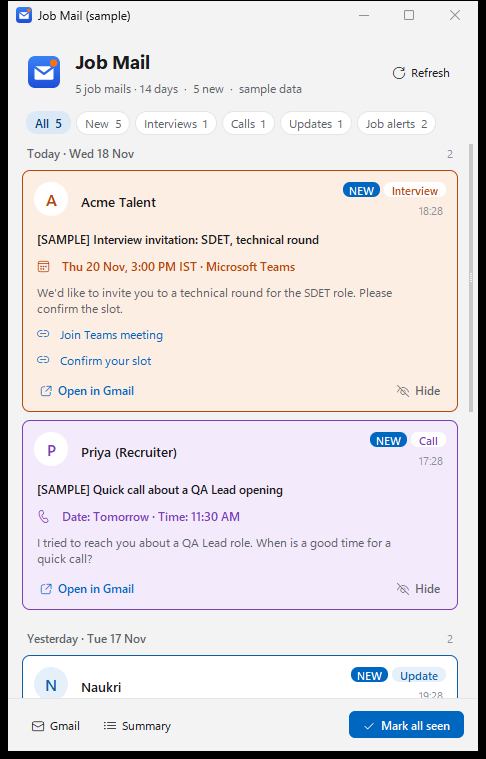

# Automation Tools

Small Python tools that automate everyday tasks on Windows. Each tool lives in its own folder, has its own setup and README, and shares no code with the others.

| Folder | What it does | When it runs |
|---|---|---|
| [`task_01_job_mail_notifier`](task_01_job_mail_notifier/README.md) | Reads Gmail over IMAP (app password, no AI) for interviews, recruiter calls, application updates and job alerts. Lists them day by day in an always-on desktop popup, with Gmail and job-portal links. | At sign-in, every 2 min and on unlock (Task Scheduler) |



## Getting started

```powershell
git clone https://github.com/NILANJAN-01/Automation-Tools.git
cd Automation-Tools\task_01_job_mail_notifier
powershell -ExecutionPolicy Bypass -File .\install_task.ps1
```

Each tool needs Windows 10/11 and Python 3.11+. See the tool's README for details.

## Conventions

- One folder per tool (`task_NN_<name>/`), with its own `.venv`, `requirements.txt`, `main.py`, `README.md` and `tests/`. Tests use the standard-library `unittest`.
- Scheduled runs use Windows Task Scheduler, registered by the tool's `install_task.ps1`.
- Secrets and personal data never go in the repo. They stay in Windows Credential Manager, `.env` or the tool's `data/`, `logs/` and `reports/` folders, all git-ignored.

## License

[MIT](LICENSE)
