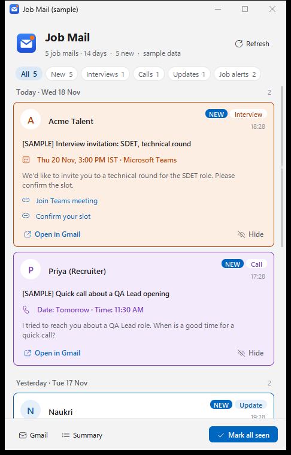

# Job Mail Notifier

A small Windows desktop app that watches your Gmail for **interviews**, **recruiter calls**, **application updates** and **job alerts**. It lists them, day by day, in a window that is always on your desktop. Each card links to the mail in Gmail and to the job portal.

- Reads Gmail directly over IMAP with a Gmail **app password**. No AI, no cloud service, no cost.
- Mail is sorted with plain keyword rules that you can extend in `rules.toml`.
- Opens the mailbox **read-only**: nothing is marked as read, moved or deleted.



## What the popup does

- **Lists every job mail of the last 14 days, grouped by day** (Today, Yesterday, Monday 16 Nov…), newest first.
- **Highlights what matters:**
  - Interviews (orange) and calls (purple) get a tinted card.
  - New mails get a coloured border and a **NEW** badge until you open them or click **Mark all seen**.
- **Shows the details:** the interview or call date and time when the mail gives one, including the start time of calendar invites, plus a short excerpt.
- **Links each card:**
  - **Open in Gmail** opens that exact mail.
  - **Portal links** found in the mail: *Apply now*, job titles, *Join Teams meeting*, assessment links. Unsubscribe, social and tracking junk is left out.
- **Filters** (All, New, Interviews, Calls, Updates, Job alerts), **Refresh** (or F5) to check now, and **Hide** to drop a card.
- **Stays around:**
  - **Minimise** it any time; it comes back with a chime when new job mail arrives.
  - **✕ hides it for 2 minutes.**
  - If it's killed, the next scheduled check restarts it.
- **Reports problems:** if a check fails (wrong password, no internet), a red banner says why.
- **Summary page:** **Summary** opens an HTML version of the list in your browser.

## Requirements

- Windows 10 or 11
- Python 3.11 or newer, from [python.org](https://www.python.org/downloads/). Tick "Add python.exe to PATH" when installing.
- A Gmail account with 2-Step Verification turned on (needed for app passwords)

## Install

```powershell
git clone https://github.com/NILANJAN-01/Automation-Tools.git
cd Automation-Tools\task_01_job_mail_notifier
powershell -ExecutionPolicy Bypass -File .\install_task.ps1
```

The installer:
1. creates a virtual environment (`.venv`) and installs the two dependencies: `winotify` for notifications and `keyring` for Credential Manager.
2. asks for your **Gmail address** and **app password**. To get one:
   1. Turn on [2-Step Verification](https://myaccount.google.com/signinoptions/twosv).
   2. Open [myaccount.google.com/apppasswords](https://myaccount.google.com/apppasswords) and create one named "Job Mail".
   3. Paste the 16 letters. The installer tests the login and saves the password in **Windows Credential Manager**.
3. registers two Task Scheduler tasks, running as you with no admin rights needed:
   - **at sign-in:** starts the popup and checks Gmail
   - **every 2 minutes and on unlock:** checks Gmail and restarts the popup if it was closed

The first check looks back 7 days. To fill the popup with a full 14 days right away:

```powershell
.\.venv\Scripts\python.exe main.py --days 14
```

If "App passwords" says *"The setting you are looking for is not available"*, 2-Step Verification is off. It can also mean your only second step is a security key, or Advanced Protection is on.

## Everyday use

```powershell
.\.venv\Scripts\pythonw.exe popup.py               # bring the popup to the front
.\.venv\Scripts\python.exe main.py                 # check now (same as Refresh)
.\.venv\Scripts\python.exe main.py --dry-run --days 3   # print what it would find, with links
.\.venv\Scripts\python.exe main.py --setup         # change the Gmail address or app password
.\.venv\Scripts\python.exe main.py --test-popup    # a separate popup with sample data
```

| `main.py` option | Effect |
|---|---|
| `--setup` | Enter the Gmail address and app password, test the login and save them. |
| `--dry-run` | Print results only. No popup, nothing saved. |
| `--days N` | Look back N days instead of "since the last check". |
| `--all` | Re-read mails already looked at (after changing the rules). |
| `--test-popup` | Open a popup with sample mails. |
| `--forget` | Delete the saved app password from Credential Manager. |

Optional settings go in `.env`; copy `.env.example`. They cover: days listed (`HISTORY_DAYS`), how soon a closed popup returns (`REOPEN_MINUTES`), the theme (`THEME=auto|light|dark`) and the lookback window. To check more or less often: `install_task.ps1 -IntervalMinutes 5`.

## Sorting rules

Each mail found by the Gmail search goes into the first category that matches:

| Category | Matches, for example |
|---|---|
| **Interview** | interview, assessment, coding test, technical/HR round, walk-in, a calendar invite about a role |
| **Call** | phone screen, "quick call", "tried to reach you", "share your number". It must also mention a job, role or CV, so sales calls are skipped. |
| **Application update** | applied, application received/viewed, shortlisted, rejected, offer, "recruiter viewed your profile" |
| **Job alert** | "is hiring", job alerts, recommended jobs, vacancies, career opportunities, mail from job boards |
| *left out* | CI/build "job failed" mails, webinars, courses, newsletters, interview-tips articles, your own mail |

**Built-in job boards:** LinkedIn, Indeed, Glassdoor, Naukri, foundit, Monster, Instahyre, iimjobs, hirist, Shine, Cutshort, Wellfound, TimesJobs, apna, Internshala and Unstop.

**To add your own boards, keywords, phrases or noise filters,** copy `rules.example.toml` to `rules.toml` and edit it. Phrases are plain text, not regular expressions. Then re-sort recent mail:

```powershell
.\.venv\Scripts\python.exe main.py --days 14 --all
```

The built-in phrase lists are at the top of `classify.py` (sorting) and `mailparse.py` (which links are shown).

## Privacy and security

- **Where the app password is kept:** in Windows Credential Manager, encrypted with your Windows login. It is sent only to `imap.gmail.com` over TLS. If you prefer, you can put it in `.env` as `GMAIL_APP_PASSWORD` instead.
- **What it can do:** an app password gives full mailbox access, but this app only ever opens the Inbox read-only and fetches with `BODY.PEEK`.
- **Revoking access:** you can revoke the app password at any time at [myaccount.google.com/apppasswords](https://myaccount.google.com/apppasswords).
- **What is stored, on your PC only:** sender, subject, a short excerpt, the extracted links and the Gmail id of job mails. These are kept in `data/`; logs are in `logs/`, the summary page in `reports/`. Full mail bodies and attachments are never saved.
- **No other network traffic:** nothing is sent anywhere except Gmail. Links open only when you click them.
- **Git:** `.env`, `rules.toml`, `data/`, `logs/` and `reports/` are git-ignored.

## Uninstall

```powershell
powershell -ExecutionPolicy Bypass -File .\install_task.ps1 -Uninstall -ForgetPassword
```

This removes the scheduled tasks, closes the popup and deletes the saved app password. Then delete the folder, and revoke the app password in your Google account.

## How it works (for contributors)

| File | Role |
|---|---|
| `main.py` | One check: starts the popup if needed, searches Gmail, sorts, saves `data/*.json`, writes the summary page. |
| `gmail_imap.py` | IMAP: Gmail search (`X-GM-RAW`), message ids (`X-GM-MSGID`), read-only fetch of new mails only. |
| `mailparse.py` | MIME → text, links, calendar-invite time; picks the useful links. |
| `classify.py` | The sorting rules, interview/call time extraction, excerpts. `rules.py` merges `rules.toml` into them. |
| `popup.py`, `ui_kit.py` | The Tkinter window: Fluent-style theme, rounded shapes drawn into images, single instance via a localhost port. |
| `report.py` | The HTML summary page. |
| `install_task.ps1` | venv, setup and Task Scheduler tasks. |

Tests use the standard library only and never connect to Gmail:

```powershell
.\.venv\Scripts\python.exe -m unittest discover -s tests
```

## Limitations

- Windows only (Tkinter window styling, Task Scheduler, Credential Manager).
- Gmail only. It relies on Gmail's IMAP extensions; other providers would need a different search and link format.
- The rules are English keyword rules. They catch typical recruiter and job-board mail well, but an unusually worded mail can be missed. Add a phrase to `rules.toml`.
